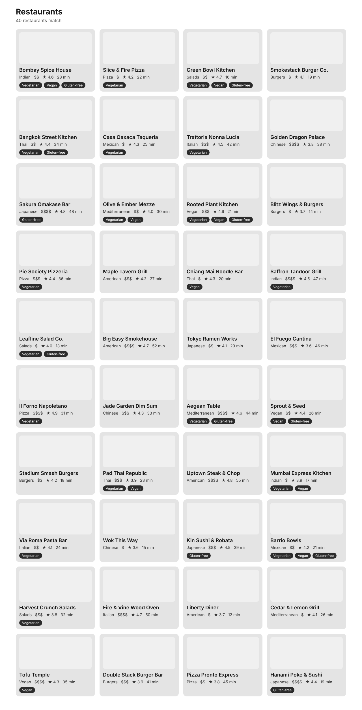

# Restaurant cards

All 40 restaurants from `data/restaurants.xlsx`, shown as cards that match the Figma wireframe. Built with Next.js and TypeScript. Four stackable filter groups (delivery time, price, dietary, rating) narrow the cards on every chip click.

Filter results compared with the expected-results check table: [docs/filter-results.md](docs/filter-results.md).



[Full-size screenshot of all 40 cards](screenshot.png)

## Run it

```bash
npm install
npm run dev      # http://localhost:3000
```

## Where the data comes from

- `data/restaurants.xlsx` is the only source of truth. It is committed as is, and no data is typed by hand.
- `npm run data` runs `scripts/convert-restaurants.ts`. The script reads every field of every row, checks it, and writes **`src/data/restaurants.json`** (committed). It stops with an error if a field is missing or has a wrong value (for example, a `price_tier` outside 1–4).
- The page loads `restaurants.json` through `src/data/loadRestaurants.ts`. A JSON import types `price_tier` as a plain `number`, so the data goes through `parseRestaurants()` (`src/lib/parseRestaurants.ts`), which checks every row and returns `Restaurant[]` with `price_tier` narrowed to `1 | 2 | 3 | 4`. No `any`, no type casts. The conversion script uses the same parser, so the rules live in one place.
- Note: the sheet stores every cell as text (`"28"`, `"4.6"`, `"true"`). The parser converts these to real numbers and booleans, so filters compare numbers, not strings.

## Types (`src/types`)

- `Restaurant`: the 9 fields of the sheet, with the same names (`delivery_time_min`, `price_tier`, `is_vegan`, ...).
- `PriceBand`: only `"$" | "$$" | "$$$" | "$$$$"`, never a plain string. `toPriceBand()` turns `price_tier` 1–4 into a band.
- `FilterState`: one field per chip group, each with a typed "nothing selected":
  - `delivery: 15 | 30 | 45 | null`
  - `price: PriceBand[]` (`[]` = nothing selected)
  - `dietary: ("vegetarian" | "vegan" | "gluten_free")[]` (`[]` = nothing selected)
  - `rating: 3.5 | 4.0 | 4.5 | null`
- `EMPTY_FILTERS`: the state with nothing selected in every group.

## Filters

- `src/lib/filterRestaurants.ts`: one pure function, `filterRestaurants(restaurants, filters)`. It returns a new list and changes nothing else. Rules from the wireframe: delivery at most the chip value (exactly 30 passes), price OR, dietary AND, rating at least the chip value (exactly 4.0 passes), AND between groups, and an empty group lets everything through.
- `src/components/RestaurantFilters.tsx`: a client component that holds `FilterState` in `useState`. Each chip click re-filters right away, with no Apply button or reload. The count is `filtered.length`. With 0 results it shows the empty state with Clear all.
- `npm run check:filters` checks the function against the four stacks in `expected-results-check-table.md`.

## Checks

```bash
npm run check    # TypeScript strict mode + ESLint
```

TypeScript `strict` is on, and ESLint's `@typescript-eslint/no-explicit-any` is set to `error`, so `any` cannot appear in the code.
