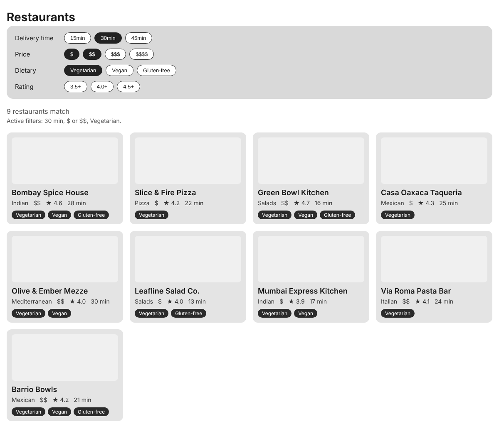
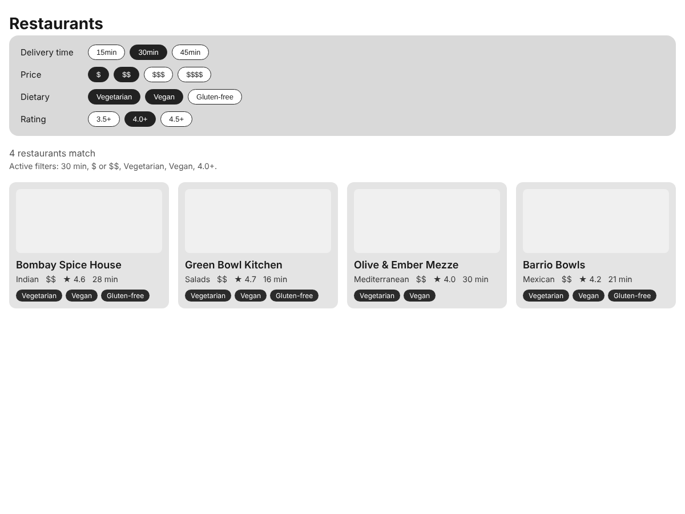
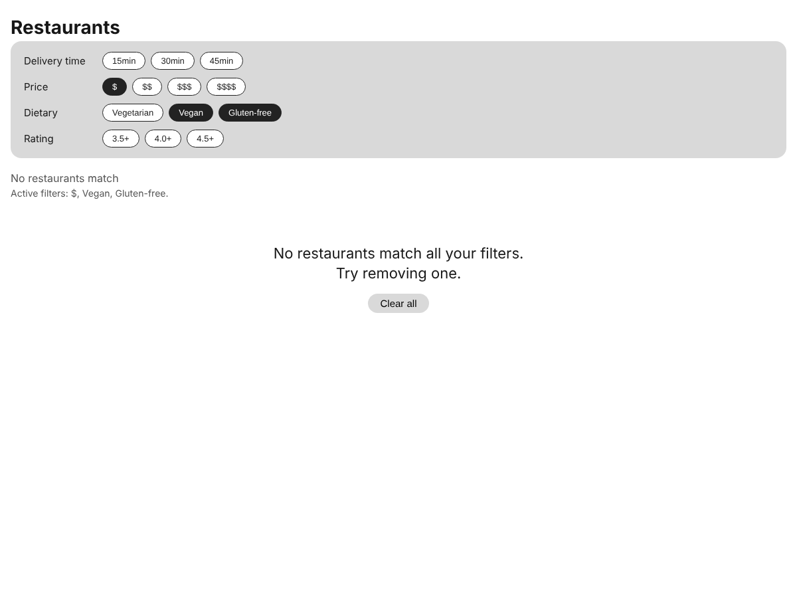
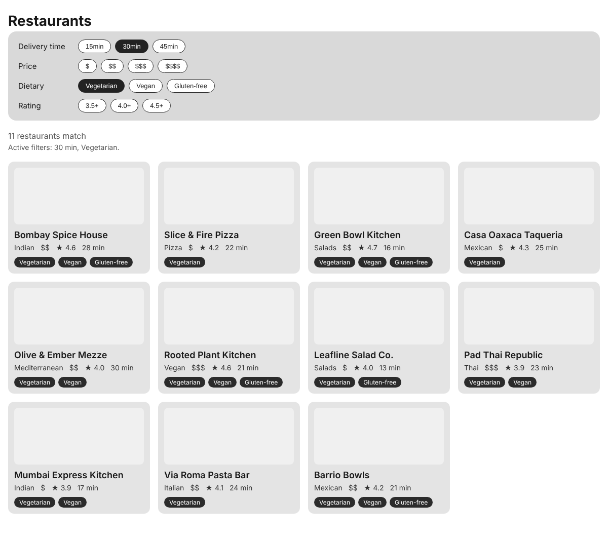

# Filter results vs. expected-results check table

Each screenshot shows the live page with one stack from [`expected-results-check-table.md`](../expected-results-check-table.md) selected. The page count is the length of the list returned by `filterRestaurants()` (`src/lib/filterRestaurants.ts`). Edge rule, same as the table: exactly 30 min passes the 30 min chip, and exactly 4.0 passes the 4.0+ chip.

| # | Active filters | Expected count | Page count | Match |
|---|---|---|---|---|
| 1 | 30 min, $ or $$, Vegetarian | 9 | 9 | ✅ |
| 2 | 30 min, $ or $$, Vegetarian, Vegan, 4.0+ | 4 | 4 | ✅ |
| 3 | $, Vegan, Gluten-free | 0 | 0 | ✅ |
| 4 | 30 min, Vegetarian | 11 | 11 | ✅ |

The names match too, not only the counts. `npm run check:filters` runs the same four stacks through `filterRestaurants()` and compares every name with the table.

Borderline restaurant: **Olive & Ember Mezze** (exactly 30 min, exactly 4.0) shows up in stacks 1, 2 and 4, as the table expects.

## 1. Vegetarian + 30 min + $ or $$ (9)

## 2. All four groups: 30 min + $ or $$ + Vegetarian + Vegan + 4.0+ (4)

## 3. Zero results: Vegan + Gluten-free + $ (0)

No restaurant is vegan and gluten-free at the $ price, so the page shows the empty state with Clear all. The active filters for this screenshot are **$, Vegan and Gluten-free**, and the page names them in the "Active filters" line above the empty state.

## 4. Vegetarian + 30 min, stack 1 without price (11)

